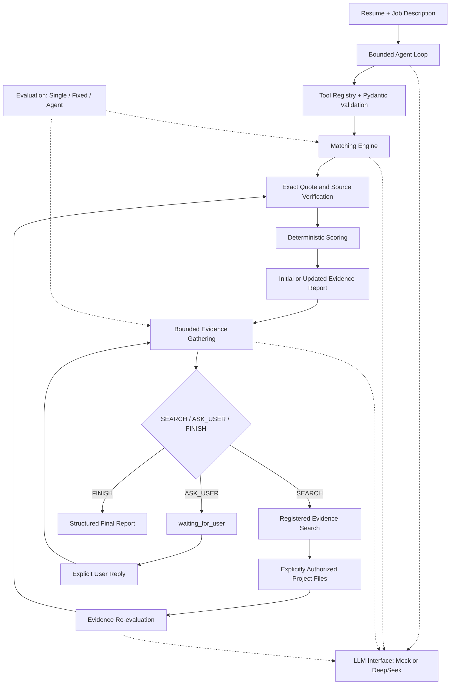

# AI Internship Agent

A framework-free Python agent for evidence-grounded resume–job matching,
with bounded tool execution, resumable evidence gathering, and reproducible
baseline comparisons.

Python 3.12 · Pydantic 2 · pytest · DeepSeek adapter · No LangGraph or LangChain

## 1. Project Overview

A resume may omit relevant project work, while a job description can combine
skills with conditions such as production experience. A useful comparison needs
traceable evidence and an explicit way to handle missing information.

This project analyzes **one Resume + one JD**, produces structured skill states
and citations, and can search explicitly authorized project files or ask the
user for clarification. The LLM proposes actions and semantic judgments;
Python validates execution, verifies quotes, enforces budgets and computes
scores. It does not apply to jobs or submit resumes.

The implementation explores whether autonomous evidence gathering justifies
its extra model calls compared with a fixed workflow. Results expose costs
and failure modes rather than claim an overall Agent advantage.

## 2. Architecture



Solid arrows show the production flow; dotted arrows show dependencies.
The matching tool contains semantic LLM calls. The later gathering stage is a
separate bounded state machine. Evaluation initializes Fixed and Agent directly
through the shared Matcher, excluding initial tool-routing overhead from both.

| Component | Implementation |
| --- | --- |
| Agent Loop and provider-neutral protocol | [agent.py](src/agent.py), [llm.py](src/llm.py), [deepseek.py](src/deepseek.py) |
| Explicit tools and strict arguments | [tool_registry.py](src/tool_registry.py), [schemas.py](src/schemas.py) |
| Evidence matching, quote verification and scoring | [matching.py](src/matching.py) |
| Authorized search and resumable gathering | [evidence_search.py](src/evidence_search.py), [autonomy.py](src/autonomy.py) |
| Baselines, frozen fixtures and reports | [evaluation/](evaluation/README.md) |

See [Architecture](docs/ARCHITECTURE.md) for execution contracts and
[Development Notes](docs/DEVELOPMENT.md) for design choices and failure cases.

## 3. Key Features

- **Custom Tool Calling loop:** sequential multi-tool execution, call/result ID
  correlation, recoverable errors and explicit step limits.
- **One tool contract:** Pydantic models generate Tool Schemas and strictly
  validate execution arguments; only registered handlers can run.
- **Grounded reports:** supported / partial / not_found / uncertain states with
  source text, line locations and content hashes; Python calculates the score.
- **Bounded autonomy:** model-selected SEARCH / ASK_USER / FINISH, explicit file
  grants, search deduplication and shared LLM request limits.
- **Human-in-the-Loop:** waiting is a real state; one finite recovery window
  follows an actual reply. User statements remain unverified leads.
- **Offline evaluation:** scripted clients, Fake SDK tests, frozen Gold,
  baseline comparisons and traceable JSON/Markdown reports.

## 4. Quick Start

Run from the repository root. Install dependencies once; the demo and tests
below run offline without an API key. The SDK is needed for the adapter tests,
even though those tests inject Fake SDK responses.

```sh
python3.12 -m venv .venv
.venv/bin/python -m pip install 'pydantic>=2,<3' pytest -r requirements-deepseek.txt
.venv/bin/python -m examples.demo_agent
.venv/bin/python -m examples.demo_autonomous_evidence
.venv/bin/python -m pytest -q
```

Latest local validation: **545 tests passed**. Mock decisions are scripted;
local tools, validation, scoring and state transitions actually execute.

The example resume is an anonymized and simplified sample adapted from the author's project experience.
This describes `examples/resume.txt`; the evaluation fixtures are fictional.

Generate fresh offline evaluation artifacts without overwriting saved reports:

```sh
.venv/bin/python -m evaluation.run --output evaluation/reports/local-mock
```

Optional paid DeepSeek runs require explicit opt-in and credentials supplied
through the process environment. The project does not load `.env`. See the
[manual evaluation procedure](evaluation/README.md#manual-live-evaluation)
for preflight, request budgets and separate output directories.

## 5. Example Workflow

The offline gathering demo uses explicitly fictional project material:

1. Initial evidence is insufficient for a required skill.
2. A preset Mock decision selects SEARCH on an authorized project file.
3. Python retrieves original text and the model proposes a supplemental state.
4. Python verifies the citation, applies evidence guards and recomputes the score.
5. The session finishes, or returns `waiting_for_user` with a specific question.

For SQL, JOIN/GROUP BY practice can coexist with synthetic data and no production
deployment. Such evidence can partially satisfy a production-qualified job
requirement without denying the underlying querying practice. A reply claiming
experience does not become verified project evidence or increase the score.

The demo also exercises empty searches, blocked repeats and bounded recovery.
Its preset decisions demonstrate control flow, not real autonomous reasoning.

## 6. Evaluation & Results

The frozen **gold-v1** dataset has **12 fictional cases and 13 skill labels**.
Labels assess whether the complete authorized materials support JD conditions,
not whether a candidate truly has an ability. It has one independent semantic
review, not a measured multi-annotator agreement study.

| Method | Decision policy and information |
| --- | --- |
| Single LLM | One call; Resume/JD only; raw judgments and optional score retained, citations unverified by the method |
| Fixed Workflow | Deterministic search/ask policy with the same authorized files, semantic judge, verifier, scorer and budgets as Agent |
| Autonomous Agent | LLM chooses actions within those same execution constraints |

Two saved live DeepSeek cases show a cost trade-off:

| Case | Fixed requests | Agent requests | Fixed tokens | Agent tokens | Fixed / Agent aligned accuracy |
| --- | ---: | ---: | ---: | ---: | --- |
| 02: supplemental RAG evidence | 3 | 5 | 2,125 | 4,488 | 1/1 / 1/1 |
| 05: SQL practice with production limits | 3 | 7 | 2,083 | 7,266 | 1/1 / 1/1 |

Tokens are historical provider usage. Accuracy in this table uses
**skill-alignment-v2**, a post-hoc evaluation protocol revision aligning explicit
aliases and preserving JD-bound conditions. It does not represent improved
model responses. Original case 05 accuracy was Fixed 1/2 and Agent 0/3, affected
by skill naming and decomposition; those reports remain unchanged.

Agent avoided an irrelevant file in case 02 but spent more model requests.
Case 05 included an additional empty search. Two cases, one run per method and
independent sampling cannot establish overall superiority or policy causality.
Mock results validate the framework, not real model accuracy.

One lossless decision-JSON formatting change reduced reconstructed offline
context from **6,115 to 5,738 characters** for case 02 and **13,672 to 12,837**
for case 05. Calls and replayed behavior were unchanged. These are character
counts, **not measured token savings**.

[Protocol and report index](evaluation/README.md) ·
[Live result audit](evaluation/reports/LIVE_ANALYSIS.md) ·
[Offline format A/B](evaluation/reports/token-cost-format-ab/offline-ab.md)

## 7. Reliability & Safety

- File roots and individual supplemental grants are application-controlled.
  Paths in model output or user replies do not grant access.
- Python rejects unauthorized reads, duplicate searches and invalid arguments.
  Permission failures stop rather than trigger path reconstruction.
- Gathering defaults to 3 searches, 5 initial decision rounds and one recovery
  window of up to 2 rounds, within a shared 12-request attempt budget.
- Failed requests consume budget. Limits return explicit termination states;
  waiting, errors and exhausted budgets are distinct from completion.
- Traces contain execution metadata, not resume text, raw arguments or secrets.
  Full reports and message histories can contain input data and require review
  before publication.

These are application-level safeguards, not an operating-system sandbox or
proof that source documents are truthful. See the [detailed contracts](docs/ARCHITECTURE.md).

## 8. Limitations

Literal retrieval can miss paraphrases. LLM extraction and semantic judgments
can be wrong; exact citations prove text exists, not that it supports a claim.
Small fixtures and sparse semantic annotations limit evaluation conclusions.

Execution is synchronous, recovery is in memory, and request/output caps are
not a hard currency budget. File checks do not prevent malicious concurrent
filesystem replacement. Inputs are UTF-8 TXT/Markdown; there is no PDF parser,
frontend, database, batch recruiter workflow or job-submission feature.

[MIT License](LICENSE)
